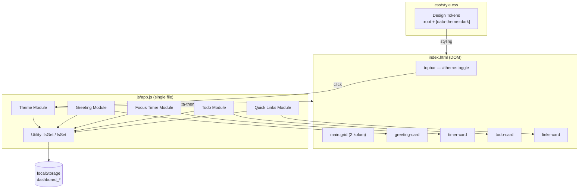
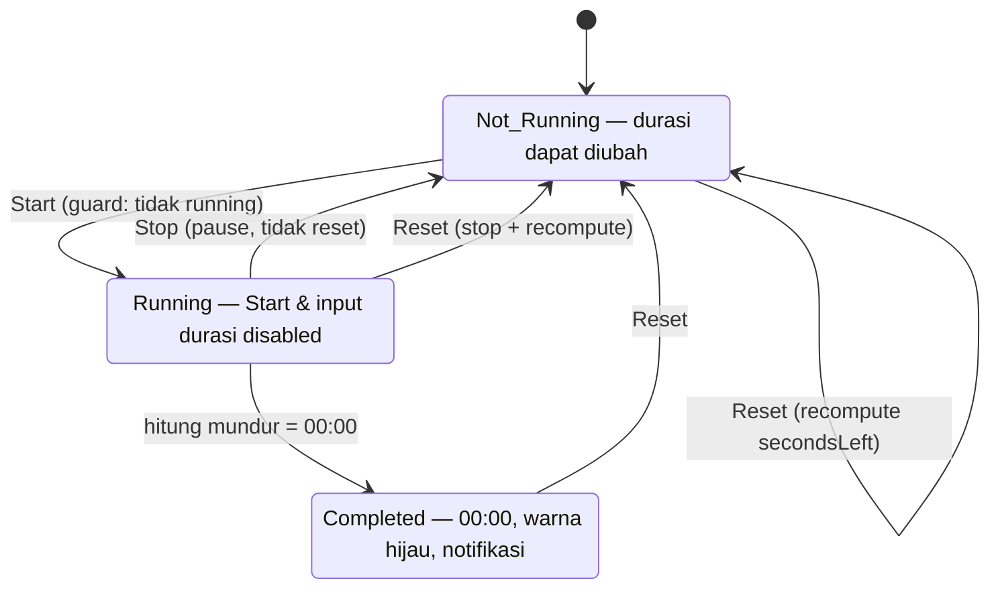

# Design Document

## Overview

Personal-dashboard adalah aplikasi web dasbor personal sisi klien (client-side) yang **sudah selesai diimplementasikan**. Dokumen ini adalah dokumentasi retroaktif terhadap kode yang ada — tidak ada perubahan kode yang dilakukan dalam pembuatan dokumen ini.

Aplikasi terdiri dari satu halaman HTML yang memuat satu file CSS dan satu file JavaScript vanilla: tanpa framework, tanpa build tool, dan tanpa server. Empat fitur fungsional ditampilkan dalam grid dua kolom — sapaan berbasis waktu, timer fokus gaya Pomodoro, daftar tugas, dan tautan cepat — ditambah tombol toggle tema terang/gelap pada topbar. Seluruh data pengguna disimpan di `localStorage` browser.

Tujuan desain adalah menyajikan antarmuka minimal yang bersih, responsif, dengan waktu muat cepat, dan nyaman dipakai di berbagai kondisi pencahayaan melalui tema terang/gelap. Karena tidak ada backend, seluruh state bersifat sisi klien dan dipersistensi via `localStorage`, sehingga data bertahan antar-sesi pada browser yang sama.

### Design Decisions and Rationale

| Keputusan | Alasan | Requirement |
|-----------|--------|-------------|
| Tanpa framework / build tool | Meminimalkan ukuran bundle dan waktu muat; dataset kecil sehingga Vanilla JS cukup | 6.1, 6.5 |
| Satu file CSS (`css/`) + satu file JS (`js/`) | Kesederhanaan dan kemudahan pemeliharaan untuk skala aplikasi ini | 6.4 |
| `localStorage` sebagai satu-satunya persistensi | Tidak ada server; state harus bertahan antar-sesi di sisi klien | 6.2 |
| CSS custom properties sebagai Design Tokens | Theming dilakukan dengan override token di `[data-theme="dark"]`, menghindari duplikasi aturan selektor | 5.4 |
| Re-render penuh pada perubahan state (`renderTasks`/`renderLinks`) | Dataset kecil sehingga pendekatan deklaratif sederhana lebih mudah dipelihara daripada diff manual | 3.x, 4.x |
| Skrip non-modul (top-level globals) | Tanpa bundler, deklarasi fungsi tingkat atas diekspos sebagai global; event handler diikat langsung pada elemen | 6.1, 6.4 |
| `setInterval` 1000 ms untuk countdown | Presisi detik cukup untuk timer Pomodoro; `clearInterval` saat stop/reset mencegah drift ganda | 2.4–2.6 |

## Architecture

Aplikasi mengikuti pola **tiga file**: markup (`index.html`), gaya (`css/style.css`), dan logika (`js/app.js`). Tidak ada lapisan transport, tidak ada server, tidak ada state manajemen pihak ketiga. `app.js` adalah satu skrip non-modul yang berisi utility persistensi, lima modul fitur, dan inisialisasi/pengikatan event di akhir file.

Alur data bersifat satu arah secara konseptual: **event pengguna → mutasi state in-memory → persistensi ke `localStorage` → re-render DOM**. Tidak ada mekanisme reaktif; setiap handler secara eksplisit memanggil fungsi render setelah memutasi state.



### Theme Architecture

Tema diterapkan lewat atribut `data-theme` pada elemen `<html>`. Token terang didefinisikan di `:root` dan di-override di selektor `[data-theme="dark"]`. Karena seluruh warna dirujuk via `var(--token)`, pergantian tema hanya mengubah satu atribut tanpa menyentuh aturan komponen.

### Focus Timer State Machine

Timer fokus adalah mesin state sederhana dengan transisi yang diguard oleh flag `timerRunning`.



## Components and Interfaces

Setiap modul adalah kumpulan fungsi dan state pada lingkup top-level `app.js`. Karena skrip non-modul, fungsi tingkat atas dapat diakses secara global (berguna untuk pengujian).

### Utility: `lsGet` / `lsSet`

| Fungsi | Signature | Perilaku |
|--------|-----------|---------|
| `lsGet(key, fallback)` | `(string, any) -> any` | `JSON.parse(localStorage.getItem(key))`; return `fallback` bila `null` atau parse error |
| `lsSet(key, value)` | `(string, any) -> void` | `localStorage.setItem(key, JSON.stringify(value))` |

### Module 1: Theme

- **State**: `isDark: boolean` (dari `lsGet('dashboard_dark', false)`)
- **Fungsi**:
  - `applyTheme(dark: boolean) -> void` — set `data-theme` pada `<html>`, perbarui emoji tombol (🌙/☀️)
- **Event**: `click` pada `#theme-toggle` → toggle `isDark`, `applyTheme`, `lsSet('dashboard_dark', isDark)`

### Module 2: Greeting

- **State**: nama dari `lsGet('dashboard_name', '')`
- **Fungsi**:
  - `getTimeGreeting() -> string` — murni dari `new Date().getHours()`: `<12` → "Good morning", `<17` → "Good afternoon", else → "Good evening"
  - `formatDatetime() -> string` — `toLocaleString('en-US', {weekday:'long', year:'numeric', month:'long', day:'numeric', hour:'2-digit', minute:'2-digit'})`
  - `updateGreeting() -> void` — tulis `#greeting-msg` dan `#datetime`
  - `saveName() -> void` — trim input, `lsSet('dashboard_name', trimmed)`, `updateGreeting()`, umpan balik visual "✓ Saved"
- **Event/Timer**: `setInterval(updateGreeting, 30_000)`; `click` pada `#save-name`

### Module 3: Focus Timer

- **State**: `timerInterval: number|null`, `secondsLeft: integer`, `timerRunning: boolean`
- **Fungsi**:
  - `getConfiguredSeconds() -> integer` — `parseInt(#timer-duration.value) * 60`
  - `formatTime(secs: integer) -> string` — `MM:SS` via `padStart`
  - `renderTimer() -> void` — tulis `#timer-display` textContent
  - `startTimer() -> void` — guard (return bila running); set `timerRunning=true`; disable Start + input durasi; `setInterval(1000)` yang decrement `secondsLeft`
  - `stopTimer() -> void` — `clearInterval`; `timerRunning=false`; enable Start
  - `resetTimer() -> void` — `stopTimer()` + enable input durasi + `secondsLeft=getConfiguredSeconds()` + reset warna + `renderTimer()`
- **Completion**: `clearInterval`; warna `#timer-display` = `var(--success)`; `Notification` API atau fallback `alert`
- **Event**: `click` pada `#timer-start`/`#timer-stop`/`#timer-reset`; `Notification.requestPermission()` sekali pada `click` dokumen pertama

### Module 4: To-Do List

- **State**: `tasks: Array<Task>` (dari `lsGet('dashboard_tasks', [])`), `sortMode: 'default'|'az'|'done'`
- **Fungsi**:
  - `saveTasks() -> void` — `lsSet('dashboard_tasks', tasks)`
  - `getSortedTasks() -> Array<Task>` — `[...tasks]` di-sort sesuai `sortMode`
  - `renderTasks() -> void` — re-render penuh `#todo-list`; tampilkan empty state bila kosong
  - `addTask() -> void` — trim; cek duplikat case-insensitive; push `{id:Date.now(), text, done:false}`; `saveTasks`; `renderTasks`; clear input
  - `toggleDone(id) -> void`; `deleteTask(id) -> void` — map/filter, `saveTasks`, `renderTasks`
  - `startEdit(id, li, span) -> void`; `finishEdit(id, input, li, span, saveBtn) -> void`; `cancelEdit(li, input, span, saveBtn) -> void`
  - `showDupWarn() -> void` — tampilkan `#todo-dup-warn`, `setTimeout` hide 2500 ms
- **Event**: `click`/`keydown` pada input + tombol Add + tombol per-item; `click` pada tombol sort

### Module 5: Quick Links

- **State**: `links: Array<Link>` (dari `lsGet('dashboard_links', DEFAULT_LINKS)`)
- **Default**: `[{id:1,label:'Google',url:'https://google.com'},{id:2,label:'YouTube',url:'https://youtube.com'},{id:3,label:'GitHub',url:'https://github.com'}]`
- **Fungsi**:
  - `saveLinks() -> void` — `lsSet('dashboard_links', links)`
  - `renderLinks() -> void` — bangun `.link-chip`: `<div>` + `<a target="_blank" rel="noopener noreferrer">` + `<button.link-chip-del>`
  - `addLink() -> void` — trim label+url; auto-prepend `'https://'` bila tidak berawalan `http://`/`https://`; push; `saveLinks`; `renderLinks`; clear input
  - `deleteLink(id) -> void` — filter; `saveLinks`; `renderLinks`
- **Event**: `click` pada tombol Add + tombol hapus per-chip

## Data Models

Seluruh data disimpan di `localStorage` sebagai JSON. Tidak ada skema server; bentuk objek adalah kontrak sisi klien.

### localStorage Keys

| Key | Tipe | Default | Pengguna |
|------|------|---------|----------|
| `dashboard_dark` | `boolean` | `false` | Theme Module |
| `dashboard_name` | `string` | `''` | Greeting Module |
| `dashboard_tasks` | `Array<Task>` | `[]` | Todo Module |
| `dashboard_links` | `Array<Link>` | `[Google, YouTube, GitHub]` | Quick Links Module |

### Object Shapes

```ts
// Satu item daftar tugas
interface Task {
  id: number;       // Date.now() timestamp, unik
  text: string;     // maks 120 karakter, unik case-insensitive
  done: boolean;    // status selesai
}

// Satu tautan cepat
interface Link {
  id: number;       // timestamp, unik
  label: string;    // maks 30 karakter
  url: string;     // selalu berawalan "http://" atau "https://"
}
```

### Invariants Data

- `Task.id` unik dalam array `tasks`.
- Tidak ada dua `Task` dengan `text.toLowerCase()` yang sama.
- `Link.url` selalu berawalan `http://` atau `https://` (dijaga oleh normalisasi saat `addLink`).
- `dashboard_dark` selalu konsisten dengan atribut `data-theme` aktif dan state `isDark`.

## Correctness Properties

*A property is a characteristic or behavior that should hold true across all valid executions of a system — essentially, a formal statement about what the system should do. Properties serve as the bridge between human-readable specifications and machine-verifiable correctness guarantees.*

Fitur ini mengandung fungsi murni (`getTimeGreeting`, `formatTime`, `getConfiguredSeconds`, `getSortedTasks`, normalisasi URL) dan invariant state (uniqueness task, persistensi, countdown) yang bervariasi bermakna terhadap input. Karena itu property-based testing (PBT) layak diterapkan. Setiap property di bawah diturunkan dari acceptance criteria pada `requirements.md` melalui analisis prework, lalu direfleksikan untuk menghilangkan redundansi (greeting + no-name disatukan; tiga mode sort disatukan; property hitung add/delete dihapus karena termuat di property uniqueness).

### Property 1: Theme State Sync

*For any* sequence of theme toggles, the in-memory flag `isDark`, the persisted value `lsGet('dashboard_dark')`, and the DOM attribute `data-theme` SHALL all agree — `data-theme === 'dark'` if and only if `isDark === true` if and only if `lsGet('dashboard_dark') === true`.

**Validates: Requirements 5.2, 5.3**

### Property 2: Greeting Correctness

*For any* hour `h` in 0–23 and any name string `n`, `getTimeGreeting()` at hour `h` SHALL return "Good morning" for `h < 12`, "Good afternoon" for `12 <= h < 17`, and "Good evening" for `h >= 17`; and the displayed greeting SHALL contain the name `n` if and only if `n` is non-empty (after trim).

**Validates: Requirements 1.1, 1.2, 1.6**

### Property 3: Name Save Round Trip

*For any* name string `n`, after `saveName(n)` is invoked, `lsGet('dashboard_name')` SHALL equal `n.trim()` and the greeting SHALL reflect the trimmed name.

**Validates: Requirements 1.5**

### Property 4: Configured Duration to Seconds

*For any* integer `v` in 1–99 supplied to the duration input, `getConfiguredSeconds()` SHALL return exactly `v * 60`.

**Validates: Requirements 2.2**

### Property 5: Timer Countdown Invariant

*For any* configured duration, while the timer is running, each tick SHALL decrement `secondsLeft` by exactly 1, and `secondsLeft` SHALL never become negative (countdown stops at 0).

**Validates: Requirements 2.4, 2.7**

### Property 6: Timer Reset Round Trip

*For any* configured duration `v` in 1–99, after `resetTimer()` is invoked, `secondsLeft` SHALL equal `getConfiguredSeconds()` (i.e. `v * 60`) and `timerRunning` SHALL be `false`.

**Validates: Requirements 2.6**

### Property 7: Task Uniqueness (Case-Insensitive)

*For any* sequence of add/edit operations, the `tasks` array SHALL never contain two tasks whose `text.toLowerCase()` values are equal.

**Validates: Requirements 3.12**

### Property 8: Task Persistence Render-Sync

*For any* task mutation (add/toggle/edit/delete), the set of tasks rendered in `#todo-list` SHALL be exactly equal to `lsGet('dashboard_tasks')`.

**Validates: Requirements 3.8**

### Property 9: Sort Correctness

*For any* `tasks` array and `sortMode` value, `getSortedTasks()` SHALL satisfy: in `default` mode the output preserves insertion order; in `az` mode `out[i].text` is lexicographically `<=` `out[i+1].text` (case-insensitive) for all `i`; in `done` mode every task with `done:false` precedes every task with `done:true`.

**Validates: Requirements 3.9, 3.10, 3.11**

### Property 10: URL Normalization

*For any* URL string `u` supplied as input, the stored `link.url` SHALL always begin with `http://` or `https://`.

**Validates: Requirements 4.3**

### Property 11: Link Persistence Render-Sync

*For any* link mutation (add/delete), the set of links rendered as `.link-chip` elements SHALL be exactly equal to `lsGet('dashboard_links')`.

**Validates: Requirements 4.7**

## Error Handling

Penanganan error mengikuti prinsip "graceful degradation" pada data sisi klien dan fallback pada API browser.

| Skenario | Penanganan saat ini | Requirement |
|----------|---------------------|-------------|
| `localStorage` berisi JSON invalid / `null` | `lsGet` menangkap error parse dan mengembalikan `fallback` (default modul) | 1.x, 3.8, 4.7 |
| `localStorage` penuh / dinonaktifkan (mode privat) | `lsSet` tidak di-guard; potensi throw yang tidak ditangkap. Asumsi: browser modern dengan `localStorage` aktif (Req 6.2/6.3) | 6.2 |
| Menambah/edit task duplikat (case-insensitive) | Ditolak; `showDupWarn()` menampilkan `#todo-dup-warn` yang auto-hilang 2500 ms | 3.12 |
| URL tanpa skema `http://`/`https://` | `addLink` otomatis prepend `https://` sebelum menyimpan | 4.3 |
| `Notification` tidak diizinkan / tidak didukung | Timer completion dijatuhkan ke `alert` sebagai fallback; `Notification.requestPermission()` dipicu sekali pada klik dokumen pertama | 2.7, 2.8 |
| `startTimer` saat sudah running | Guard `return` awal mencegah interval ganda | 2.4 |
| Mode edit dibatalkan (Escape) | `cancelEdit` memulihkan elemen `span` dan tombol edit tanpa menyimpan | 3.6 |
| `Task_List` kosong | `renderTasks` menampilkan empty state, bukan daftar kosong | 3.x |
| `Quick_Links` tanpa data tersimpan | `lsGet` mengembalikan `DEFAULT_LINKS` (Google, YouTube, GitHub) | 4.8 |
| Input task/label melampaui batas karakter | Dibatasi atribut `maxlength` pada input (task 120, label 30) | 3.2, 4.2 |

### Catatan Resiko

- `lsSet` tidak membungkus `localStorage.setItem` dalam `try/catch`. Pada environment yang memblokir storage, operasi tulang akan melempar exception yang tidak ditangkap. Ini adalah asumsi eksplisit bahwa browser mendukung `localStorage` (Req 6.3). Tidak ada perubahan yang dilakukan; hanya didokumentasikan.
- `Notification.requestPermission()` dipanggil pada klik dokumen pertama tanpa guard terhadap browser yang tidak mendukung `Notification`; fallback `alert` hanya aktif pada completion.

## Testing Strategy

Pendekatan ganda: **unit test** untuk contoh spesifik, edge case, dan kondisi error, serta **property-based test** untuk invariant universal. Keduanya saling melengkapi — unit test menangkap bug konkret, property test memverifikasi kebenaran umum.

### Lingkup Pengujian

Aplikasi adalah skrip non-modul vanilla JS yang memanipulasi DOM dan `localStorage`. Karena fungsi tingkat atas pada skrip non-modul diekspos sebagai global, pengujian dilakukan dengan memuat `app.js` di environment DOM terpur (jsdom) dan memanggil fungsi/berinteraksi via event.

### Property-Based Testing

- **Library**: [fast-check](https://fast-check.dev/) (library PBT standar untuk JavaScript).
- **Runner**: vitest dengan environment `jsdom` (menyediakan `document`, `window`, `localStorage`, dan `Notification`).
- **Pemuatan**: `app.js` dimuat sebagai skrip di jsdom agar fungsi (`lsGet`, `lsSet`, `getTimeGreeting`, `formatTime`, `getConfiguredSeconds`, `getSortedTasks`, dll.) dan state tersedia secara global.
- **Konfigurasi**: setiap property test dijalankan minimal **100 iterasi**.
- **Tag**: setiap test diberi komentar referensi property desain dengan format:
  `**Feature: personal-dashboard, Property N: <property_text>**`
- **Satu test per property**: setiap correctness property diimplementasikan sebagai **satu** property-based test.
- **Mock**: untuk property yang menyentuh `localStorage`/`Notification`, gunakan mock jsdom (bukan panggilan nyata) agar biaya rendah dan deterministik; `Date`/`Math.random` di-stub bila perlu untuk determinisme.

### Unit Tests (contoh & edge case)

Kriteria yang tidak universal diuji dengan contoh konkret:

- **Greeting**: format tanggal/waktu untuk tanggal representatif menghasilkan pola "Weekday, Month D, YYYY · H:MM AM/PM" (Req 1.3); greeting awal saat `dashboard_name` kosong (Req 1.6).
- **Timer**: tampilan awal `25:00` (Req 2.1); Start menonaktifkan tombol+input saat running (Req 2.3); Stop mempertahankan `secondsLeft` (Req 2.5); completion mengubah warna hijau + notifikasi (Req 2.7); fallback `alert` saat permission denied (Req 2.8).
- **Todo**: batas 120 karakter (Req 3.2); checkbox → strikethrough + opacity (Req 3.3); edit → input field (Req 3.4); simpan via tombol/Enter (Req 3.5); batal via Escape (Req 3.6); peringatan duplikat muncul lalu hilang 2500 ms (Req 3.12 display).
- **Links**: batas 30 karakter label (Req 4.2); render sebagai chip (Req 4.4); hapus chip (Req 4.6); default links saat kosong (Req 4.8).
- **Theme**: ikon 🌙/☀️ ditampilkan (Req 5.1).

### Integration / Smoke Tests

- **Smoke (konfigurasi)**: token desain didefinisikan di `:root` dan di-override di `[data-theme="dark"]` (Req 5.4); `<a>` chip memiliki `target="_blank"` dan `rel="noopener noreferrer"` (Req 4.5); struktur file satu CSS di `css/` dan satu JS di `js/` (Req 6.4); tidak ada import framework (Req 6.1); tidak ada panggilan jaringan/server (Req 6.2).
- **Integration**: `setInterval(updateGreeting, 30000)` terdaftar dengan delay 30000 (Req 1.4); `Notification.requestPermission()` dipanggil sekali pada klik pertama (Req 2.7/2.8).
- **Manual/cross-browser**: kompatibilitas Chrome, Firefox, Edge, Safari (Req 6.3); responsif ≤700px menjadi 1 kolom (Req 6.5) — diverifikasi manual karena berkaitan rendering viewport.

### Traceability Ringkas

| Property / Test | Requirement |
|-----------------|-------------|
| Property 1 | 5.2, 5.3 |
| Property 2 | 1.1, 1.2, 1.6 |
| Property 3 | 1.5 |
| Property 4 | 2.2 |
| Property 5 | 2.4, 2.7 |
| Property 6 | 2.6 |
| Property 7 | 3.12 |
| Property 8 | 3.8 |
| Property 9 | 3.9, 3.10, 3.11 |
| Property 10 | 4.3 |
| Property 11 | 4.7 |
| Unit tests | 1.3, 2.1, 2.3, 2.5, 2.7, 2.8, 3.2–3.6, 4.2, 4.4, 4.6, 4.8, 5.1 |
| Smoke/Integration | 1.4, 4.5, 5.4, 6.1, 6.2, 6.4 |
| Manual | 6.3, 6.5 |
